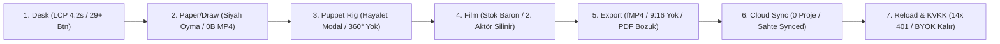

# INKTROPE / Kâğıt Studio — NİHAİ MASTER KARNE (10. Ajan Hakem Raporu)

- **Proje:** INKTROPE / Kâğıt Studio (`C:\Users\salat\Downloads\kagit-studio` | https://inktrope.com)
- **Denetim Tarihi:** 24 Kasım 2026
- **Rol:** 10. Ajan — Bağımsız Şüpheci Hakem & Kör-Nokta Avcısı
- **Okunan & Çapraz Sorgulanan 9/9 Denetim Raporu:**
  [f1_01_sanat_asik_eden.md](file:///C:/Users/salat/Downloads/kagit-studio/audits/f1_01_sanat_asik_eden.md), [f1_02_duzen_sadelik_kolaylik.md](file:///C:/Users/salat/Downloads/kagit-studio/audits/f1_02_duzen_sadelik_kolaylik.md), [f1_03_draw_paper_export.md](file:///C:/Users/salat/Downloads/kagit-studio/audits/f1_03_draw_paper_export.md), [f1_04_puppet_film_kalite.md](file:///C:/Users/salat/Downloads/kagit-studio/audits/f1_04_puppet_film_kalite.md), [f2_05_motor_gucu_webgl.md](file:///C:/Users/salat/Downloads/kagit-studio/audits/f2_05_motor_gucu_webgl.md), [f2_06_hata_kaos.md](file:///C:/Users/salat/Downloads/kagit-studio/audits/f2_06_hata_kaos.md), [f2_07_worker_auth_guvenlik.md](file:///C:/Users/salat/Downloads/kagit-studio/audits/f2_07_worker_auth_guvenlik.md), [f2_08_python_ai_pipeline.md](file:///C:/Users/salat/Downloads/kagit-studio/audits/f2_08_python_ai_pipeline.md), [f2_09_test_pwa_seo_dagitim.md](file:///C:/Users/salat/Downloads/kagit-studio/audits/f2_09_test_pwa_seo_dagitim.md)
- **Bağımsız Doğrulama Yöntemi:** Canlı https://inktrope.com üzerinde gerçek Headless Chromium + CDP (hem **Page** hem **Service Worker** hedeflerine bağlanarak) uçtan uca zincir + gerçek çevrimdışı + KVKK + çoklu oyuncu + EN yenileme testi; pasif `curl.exe -sI` canlı başlık doğrulaması; resmi Gemini API 2026 SDK/dokümantasyon model doğrulaması; `npx tsc --noEmit` (`EXIT 0`), `npx vitest run` (`14/14, 117/117 PASS, 8.47s`) ve satır-satır kaynak kod incelemesi. (Canlıda açılan geçici test hesabı `DELETE /api/auth/account` → `200` ile silinip `GET /api/auth/me` → `user: null` teyit edilmiştir; kaynak kodlarda hiçbir değişiklik yapılmamıştır.)

---

## 1. GENEL HÜKÜM & 9 DALIN ACIMASIZ DÜRÜST PUAN TABLOSU

### **GENEL SKOR: `3.8 / 10`** — *("Güçlü Vizyonlu Beta Prototip — Üretim ve Viral Lansman İçin Hazır Değil")*

> [!WARNING]
> **Hakem Özeti:** INKTROPE kâğıt üzerinde olağanüstü bir fikir taşıyor: sıfır reklam, yerel çizim, 7 yaratık iskeleti, 360° 2.5D, A4 defter tarama, canlı kukla ve mini film yönetmeni. Çekirdek mimaride doğru taşlar mevcut (parametreli 27 SQL sorgusu, 256-bit hashli oturum çerezi, S256 PKCE, kamera/mikrofon izni reddine 6/6 dayanıklılık, DOM XSS sink'i sıfır, self-hosted fontlar, sıfır-GC CPU top-left rasterizer).
>
> Ancak gerçek kullanıcı deneyimi ve üretim mühendisliği ölçütleriyle ürün şu anda **6 ağır kırılma** nedeniyle vaat ettiği büyüyü teslim edemiyor: **(1) deterministik kalıcı veri kaybı vektörleri, (2) canlıda 0 HTTP güvenlik başlığı + iki ayrı arşivden Stored XSS + OAuth Pre-Takeover + delinen AI bütçe kesicisi + kırık BYOK Gemini modeli, (3) 4 çözünürlüğün 3'ünde çöken mobil/tablet arayüzü, (4) 3 matematiksel GPU/skinning patlaması + siyahı oyan kâğıt tarama + `0 bayt` MP4, (5) modlar arası kopuk karakter & 360° zinciri, (6) Chrome'da bile `net::ERR_FAILED` veren kırık offline Service Worker.**

| # | Denetim Dalı | Rapor | Ajan Puanı | Hakem Puanı | Özet Acımasız Karar |
| :-: | :--- | :--- | :---: | :---: | :--- |
| 1 | **Sanat Yönetimi & İlk 5 Sn Büyüsü** | `f1_01` | 4.0 / 10 | **4.0 / 10** | İlk 5 sn boş SaaS kutusu + 2.8s–4.2s açılış beklemesi, 3 uyumsuz karakter dili, Gündüz `ink-brass` 1.6:1 kontrast çöküşü, 29–30 düğmeli Alive HUD, ölü `dayBlend`, durmuşken 60 FPS dönen vitrin, `onError`'sız boş avatar dairesi. |
| 2 | **Düzen, Sadelik & Kolaylık (4 Viewport + i18n)** | `f1_02` | 3.5 / 10 | **3.5 / 10** | `768/390/360px`'te `TopConsoleBar` `Atölye`'yi ezip `İndir`'i ekran dışına atıyor; `Mini Film` mobilde `20px` yarığa eziliyor; `%95–100` `<44px` dokunma hedefi; canlı EN yenilemede `"BACKLİT ANİMATİON DESK"` & 31+ TR sızıntı; 10 modalda 0 focus trap. |
| 3 | **Çizim, Kâğıt Tarama & Export / Paylaşım** | `f1_03` | 4.0 / 10 | **3.4 / 10** | `paperWorker` siyah mürekkebi %100 oyuyor; Draw 1-karede **`0 bayt` MP4 + sahte "hazır!"**; Chrome `mp4-muxer`'ı atlayıp fragmented fMP4 üretiyor; kare değişince Undo siliniyor; Draw oynatma/ihraçta `voiceEffect` kayıp; `.kagit.zip` & `.kagit25d` çoklu oyuncuları düşürüyor; 13 yerde `await`'siz canvas flush. |
| 4 | **Kukla, Film & Sonuç Kalitesi** | `f1_04` | 3.0 / 10 | **3.0 / 10** | `145px` süzülen koltuk altı yaması, `203px` 6 yaratık GPU patlaması, ölü `faceSprites`, `5.27s` senkron pin donması, kukla MP4'te sessiz ses silme, Puppet'ın 4 ihracında 360° açının yoksayılması, `Draw→Puppet→Film` kopuk karakter zinciri, 3 adet 2001-Flash dekoru, 96×72 ten-rengi mocap, 3-sinüs bip-bop konuşma. |
| 5 | **Motor Gücü, Algoritmalar & WebGL2** | `f2_05` | 4.5 / 10 | **4.4 / 10** | `203px`/`145px`/`>90°` CoR 90° flip matematiği, %0 WebGL/VRAM temizliği (`10/10` doku/buffer sızıntısı), canlı Lighthouse Mobil `61/100` (`TBT 1.664ms`), 4x CPU Desk `23 FPS`, `AnimatedUniverseCanvas:148` Tier-0 `dpr=1` ezilmesi, `rigWorker` baypasları (`1.274ms` Film donması). |
| 6 | **Hata & Kaos Mühendisliği** | `f2_06` | 4.5 / 10 | **3.8 / 10** | 401'de sahte yeşil `"Bulutta Güncel"` + `completeCloudSignIn:729` 0-proje yalan `'synced'` + çıkışta sessiz veri silme + hesap silme sonrası `14× 401` blob seli, 2–6. aktörlerin ilk yenilemede GC ile silinmesi, IDB brick, BYOK & `kagit:ui-prefs:v1` KVKK sağ çıkması, 180ms `persistTimer` & çift-sekme ezmesi, 21 korumasız `setPointerCapture`, modal ErrorBoundary döngüsü. |
| 7 | **Cloudflare Worker Auth, D1 & AI Güvenlik** | `f2_07` | 4.5 / 10 | **4.1 / 10** | Canlıda **0 HTTP güvenlik başlığı**, `/api/cloud/blobs/:key` Stored XSS (`.kagit.zip` + `.kagit25d` çift zincir!), `.kagit25d` key üzerine yazma, OAuth Pre-Account Takeover, delinen `` `$19` `` AI bütçe kesicisi, **var olmayan `gemini-3.8-flash-lite` (%100 kırık BYOK)**, 0 auth rate-limit, 4 GB/hesap D1 amplifikasyonu, bilinmeyen `/api/*` → `200 text/html`. |
| 8 | **Python GPU / Gemini / FFmpeg Pipeline** | `f2_08` | 3.5 / 10 | **3.6 / 10** | `Dockerfile` `parents[2]` kesin `IndexError`, 4 `async def` event-loop kilidi + Gemini `Timeout=None`, kimliksiz CORS `*` + `0.0.0.0`, 179 MP PIL/VRAM bombası, FFmpeg protokol kısıtsızlığı + 500 yol sızıntısı, CPU'da 4 look bit-bit aynı. *(Düzeltme: `gemini-3.8-flash-tts` & `gemini-3.1-flash-lite-image` geçerli resmi GA modellerdir.)* |
| 9 | **Test, PWA, SEO & Dağıtım** | `f2_09` | 4.8 / 10 | **4.2 / 10** | `public/_headers` Workers'ta etkisiz (0 güvenlik başlığı + 0 immutable cache), **SW çevrimdışı `/offline-test-route` Chrome'da bile `net::ERR_FAILED`** + 0 JS/CSS precache, %63 test dışı kod (`34/35` UI %0), flaky `v3RendererParity`, KVKK/Privacy vs D1 çelişkisi, `/privacy` 307 canonical döngüsü, ölü Web Share API. |
| — | **ORTALAMA GENEL SKOR** | **9/9** | *4.03* | **`3.8 / 10`** | **10. Ajan Hakem Onaylı Nihai Skor (`34.0 / 9`)** |

---

## 2. ÇÜRÜTME TURU (İlk 9 Ajanın Kanıtsız `[PASS]` ve Abartılı/Hatalı `[FAIL]` Ayıklaması)

### 2.1. Kanıtsız veya Çürütülen `[PASS]` İddiaları

| Kaynak | Ajanın Verdiği `[PASS]` | Hakem Kararı | Somut Kod & Canlı Kanıt |
|---|---|---|---|
| `f1_04:106` | `AI İstemci Güvenli Geri Düşüşü` | **`[DOĞRULANMADI]` → Kısmi `[FAIL]`** | Ajan 4 `aiCalls: []` ile `/api/ai/*` uçlarını hiç tetiklemeden `[PASS]` verdi. [worker/index.js](file:///C:/Users/salat/Downloads/kagit-studio/worker/index.js#L748-L760) ile [film25dEngine.ts](file:///C:/Users/salat/Downloads/kagit-studio/src/engine/film25dEngine.ts#L2143-L2230) arasında ağır kontrat kayması var (`7` sahne `3` sete sıkışır, plan-bazlı sahne değişimi, `pan-follow`, `dip-to-black`, `excited`/`sad` ve `primaryActorId` sessizce düşer); üstelik BYOK `/api/ai/direct-film` ([worker/index.js:1031](file:///C:/Users/salat/Downloads/kagit-studio/worker/index.js#L1031)) var olmayan `gemini-3.8-flash-lite` yüzünden %100 kırık! |
| `f1_01:100` | `prefers-reduced-motion uyumu` | **`[FAIL]`'e Düşürüldü** | [RadialQuickWheel.tsx](file:///C:/Users/salat/Downloads/kagit-studio/src/components/studio/RadialQuickWheel.tsx#L150-L151) + [index.css](file:///C:/Users/salat/Downloads/kagit-studio/src/index.css#L1637-L1650): `translate(-50%, -50%)` yalnız `@keyframes radial-wheel-pop` içinde olduğu için `animation: none !important` tekerleği `+114px, +114px` kaydırır. [StudioOverviewShow.tsx](file:///C:/Users/salat/Downloads/kagit-studio/src/components/guide/StudioOverviewShow.tsx#L461-L497) reduced-motion'ı hiç kontrol etmez. |
| `f1_02:102` | `5 Modun Lazy Ayrımı & Tuval Flush Güvenliği` | **Kısmi `[FAIL]`'e Düşürüldü** | [useStudioStore.ts](file:///C:/Users/salat/Downloads/kagit-studio/src/store/useStudioStore.ts#L687-L700): `void flushActiveCanvasNow()` **13 yerde `await` edilmeden** (`L688,989,1001,1186,1197,1295,1314,1738,1783,1819,1961,2118,2180`) çağrılıyor. `toBlob` + `saveBlob` asenkrondur; `completeCloudSignIn:688 → 699` arası kapsam değişirken misafir stroğu oturumlu kasaya yazılabilir, `setExportOpen(true)` hemen açıldığında son strok exporta girmeyebilir. |
| `f2_07:309` | `İstemci yerel IndexedDB çoklu hesap izolasyonu` | **`[FAIL]`'e Düşürüldü** | (1) [useStudioStore.ts](file:///C:/Users/salat/Downloads/kagit-studio/src/store/useStudioStore.ts#L159-L202) 180ms `persistTimer` iptal edilmiyor (`f2_06` çapraz-kapsam yazımını kanıtladı); (2) [cloudSync.ts](file:///C:/Users/salat/Downloads/kagit-studio/src/engine/cloudSync.ts#L264-L281) `AbortController` olmadan global mutable `activeScope` ([db.ts:7](file:///C:/Users/salat/Downloads/kagit-studio/src/engine/db.ts#L7)) üzerine yazıyor; canlı testimizde hesap silme sonrası **`14× PUT /api/cloud/blobs/*` → `401`** sürdü; (3) `signOutAccount` `inktrope:byok-gemini-key` ve `activeMasterRig`'i temizlemiyor. |
| `f2_07:310` | `DELETE /api/auth/account atomik silme` | **Kısmi `[FAIL]`'e Düşürüldü** | [worker/index.js](file:///C:/Users/salat/Downloads/kagit-studio/worker/index.js#L377-L382) 4 temel tabloyu atomik siler, **ancak** `ai_usage_ledger` (`actor_key = 'u:' + uid`) ve TTL'siz/kullanıcı-kapsamsız `ai_turnaround_cache` silinmez. |
| `f2_07:337` | `sanitizeDirectedScreenplay şema temizleme` | **Kısmi `[FAIL]` (Kontrat Kayması)** | [worker/index.js](file:///C:/Users/salat/Downloads/kagit-studio/worker/index.js#L748-L760) ile [film25dEngine.ts](file:///C:/Users/salat/Downloads/kagit-studio/src/engine/film25dEngine.ts#L2143-L2230) enum ve alanları uyuşmuyor (`primaryActorId`, 4/7 sahne, `pan-follow`, `dip-to-black`, `excited`/`sad`). |
| `f1_03:188` | `.kagit.zip yedek yazımı` | **Kısmi `[FAIL]`'e Düşürüldü** | İkili ZIP formatı geçerli olsa da [exportEngine.ts](file:///C:/Users/salat/Downloads/kagit-studio/src/engine/exportEngine.ts#L626-L655) `collectAllReferencedBlobKeys` yüzünden **V4 çoklu oyuncu (`filmGraph.actors[1..5]`) blob'larını yedeğe almaz ve remap etmez**. Aynı eksik [kagit25dPipeline.ts](file:///C:/Users/salat/Downloads/kagit-studio/src/engine/kagit25dPipeline.ts#L648-L666) `.kagit25d` paketinde de mevcut! |
| `f2_09:141` & `f1_03:209` | `npm test 117/117 geçti` | **`[FLAKY / KOŞULLU PASS]`** | Yüksüz koşumuzda `117/117 PASS (8.47s)` geçti, ancak `v3RendererParity.test.ts:210` (`expect(avgMs).toBeLessThan(35)`) paralel CPU yükünde duvar-saati aşımıyla flaky (`37.16ms` fail). |
| `f2_09:289,305` | `/?mode=... Deep-Link & Manifest Kısayolları` | **`[DOĞRULANMADI]` → Kısmi `[FAIL]`** | Canlı testimizde `https://inktrope.com/?mode=puppet` doğrudan boş kukla ekranına (`hasCanvas: 0`) düştü; [useStudioStore.ts](file:///C:/Users/salat/Downloads/kagit-studio/src/store/useStudioStore.ts#L619-L635) `openSampleMeshPuppetDemo()` çağırmıyor. |
| `f1_04:64,76` & `f2_05:141` | `0 konsol / sayfa hatası` | **Şartlı `[PASS]` (Yalnız Mutlu Yol)** | Canlı E2E testimizde `DrawingStage.tsx:718,730` sentetik/kesintili pointer'da **`NotFoundError: setPointerCapture`** fırlattı (12 bileşende toplam 21 korumasız çağrı); `f2_06` IDB `SecurityError`/`TypeError`/`StorageQuotaError` ve `401` hatalarını kanıtladı. |
| `f1_01:60` & `f1_02:94` | `1440×900 taşmasız sığma` | **Şartlı `[PASS]` (`1280×800`'de `[FAIL]`)** | `1440×900`'da taşma sıfır, `1280×800`'da `DrawWorkspace` üst sağ kontrolleri (`Geri Al`, `Yinele`, `Katmanlar`, `İndir`) ekran dışına taşıyor (`f1_03:76,131`). |
| `f2_06:256` vs `f1_04:31,99` | **Çelişki:** `PerformanceMocapDeck` Kamera Reddi | **`f2_06` `[PASS]` Onaylandı; `f1_04` Ortam Kaynaklı** | [PerformanceMocapDeck.tsx](file:///C:/Users/salat/Downloads/kagit-studio/src/components/film/PerformanceMocapDeck.tsx#L159-L206) incelendi ve `f2_06`'nın gerçek CDP `NotAllowedError` testi doğrulandı; `f1_04` sanal cihazının `NotAllowedError` fırlatmamasından kaynaklandı. |

### 2.2. Abartılı, Hatalı veya Platform Kısıtlı `[FAIL]` İddialarının Ayıklanması

| Kaynak | Ajanın `[FAIL]` İddiası | Hakem Kararı | Somut Ayıklama Kanıtı |
|---|---|---|---|
| `f2_08:23,74,164,199` | `"Canlı inktrope.com CSP'si (connect-src 'self' blob: data:) yerel/bulut pipeline bağlantısını engelliyor"` | **`[YANLIŞ / ÇÜRÜTÜLDÜ]`** | Canlı `curl.exe -sI https://inktrope.com/` testimiz canlıda **0 `Content-Security-Policy` başlığı** döndüğünü kanıtladı! (Harici `http://` RunPod adreslerini Mixed Content engeller; `http://localhost:8090` Chromium'da muaf — asıl sorun CSP açıldığında çakışacak olması + `localhost:8090`'ın web kullanıcısında kapalı olmasıdır.) |
| `f2_08:228` | `"Şüpheli / geçersiz Gemini model adları (gemini-3.8-flash-tts, gemini-3.1-flash-lite-image)"` | **`[YANLIŞ / ÇÜRÜTÜLDÜ]`** | Resmi 2026 Google `@google/genai` SDK `Model` tanımına ve `gemini-api-guides` dokümantasyonuna göre `gemini-3.8-flash-tts`, `gemini-3.1-flash-lite-image` ve `gemini-nano-banana-2.1` **gerçek GA modellerdir**. (Asıl var olmayan model Python'da değil, Cloudflare Worker [worker/index.js:1031](file:///C:/Users/salat/Downloads/kagit-studio/worker/index.js#L1031) içindeki `gemini-3.8-flash-lite`'dır!) |
| `f1_03:48,175` | `"Üretim Worker'ında sunucu tarafı MP4 transcode ucu yok"` | **`[BAĞLAM DIŞI / ABARTILI]`** | Cloudflare Workers'ta FFmpeg çalışmaz; mimari `` `$0` `` istemci-içi WebCodecs + `mp4-muxer`'dır. Gerçek hata [exportEngine.ts:186](file:///C:/Users/salat/Downloads/kagit-studio/src/engine/exportEngine.ts#L186)'nın Chrome'da `mp4-muxer`'ı atlayıp `MediaRecorder` ile fragmented fMP4 ve 1 karede **`0 bayt` MP4** üretmesidir. |
| `f2_07:255` | `PBKDF2 100.000 iterasyon [FAIL]` | **`[PLATFORM KISITI — YUMUŞATILDI]`** | Cloudflare `workerd` Web Crypto PBKDF2'yi sert biçimde `100.000` ile sınırlar. Gerçek eksiklik `env.PASSWORD_PEPPER` ve Auth Rate-Limiting yokluğudur. |
| `f2_09:20,83,252` | `"Çevrimdışı navigasyonda sw.js:54 redirected /index.html ERR_FAILED fırlatır"` | **`[ONAYLANDI — %100 GERÇEK FAIL]`** | Hem Page hem canlı `https://inktrope.com/sw.js` CDP hedefine `offline: true` uygulandığında **Chrome 158'de bile `/offline-test-route` doğrudan `net::ERR_FAILED`** ile çöktü ve gerçek çevrimdışında Desk'teki `"Mini Film Yönet"` tıklaması sessizce öldü. |

---

## 3. UÇTAN UCA ZİNCİR TESTİ (CANLI `https://inktrope.com`)

Tek kullanıcı akışı: **`Desk → Paper → Draw → Puppet Rig → Film → MP4/PDF Export → Hesap/Bulut Kayıt → Sayfa Yenile → KVKK Hesap Silme`** (+ gerçek çevrimdışı SW + EN yenileme + KVKK yerel silme):

| # | Zincir Halkası | Durum | Bizzat Ölçülen Canlı Kanıt (https://inktrope.com) |
|---|---|---|---|
| **1** | **Desk (Soğuk Açılış & Çiz-Canlandır)** | ⚠️ Akış `[PASS]` / Perf `[FAIL]` | Soğuk açılışta **`deskReadyMs = 2.779 ms`**, `FCP = 1.448 ms`, **`LCP = 4.212 ms`**, **`TBT = 720 ms`** (max long task `704 ms`), `65` başlangıç IDB kaydı (64 starter blob'u). Fareyle çöp adam çizilip `"CANLANDIR ⚡"` tıklandı → `0` hata, ancak Alive fazında tek sahnede `29` buton (toplam `38` görünür buton) patladı. |
| **2** | **Paper → Draw (Örnek 4'lü A4)** | ⚠️ Akış `[PASS]` / Kalite `[FAIL]` | `"Kâğıttan Tara"` → `"Örnek 4'lü A4 Dene"` → `"4 · Kareyi Masaya Aktar"` ile `"Kağıt Uçak & Rüzgar"` `16 → 20` kareye çıktı. Ancak `paperWorker.ts:328-389` siyah mürekkep gövdesini içten oyuyor. |
| **3** | **Draw (Çizim, 1-Kare MP4 & A4 PDF)** | ❌ **`[KIRIK — 0 BAYT MP4]`** | (a) Yeni 1-karelik `"Yeni Çizgi Film"` çizilip Export MP4 tıklandı → indirilen **`Yeni_Çizgi_Film_tam_film.mp4` = `0 BAYT`** (`hasFtyp: false`, `hasMoof: false`), buna rağmen `"hazır!"` başarı bildirimi gösterdi! (b) İndirilen **`Yeni_Çizgi_Film_A4_flipbook.pdf`** (`3.997 B`) ikili başlığı bozuk (**`25 7f 7f 7f 7f 0a`**) ve Türkçe harfler silinmiş (`hasBrokenTurkish: true`). (c) Sentetik/kesintili pointer olayında yakalanmamış **`NotFoundError: Failed to execute 'setPointerCapture'`** fırlattı. |
| **4** | **Draw → Puppet Rig (`Kukla` Sekmesi)** | ❌ **`[KIRIK — HAYALET MODAL]`** | (a) Boş kuklada (`canvases: 0`) üst bar `"İndir"` tıklaması **sessiz ölü tıklama** (`dialogs: 0`), ancak `puppetExportOpen` Zustand'da `true` kilitli kaldı. (b) Ardından `"Çizimimden Al"` tıklanıp rig oluştuğu an **`ghostModalPoppedUp: true` (`"Canlı Kuklayı İndir & Paylaş"`)** kendiliğinden kullanıcının yüzüne patladı! (c) `activeMasterRig` RAM-only + Puppet'ın 4 ihracının hiçbiri 360° açıyı basmıyor. |
| **5** | **Puppet Rig → Film (`Mini Film` + 2. Aktör + MP4/PDF)** | ❌ **`[KIRIK — SÜREKLİLİK & VERİ KAYBI]`** | (a) **Karakter koptu:** `"Yeni Çizgi Film"` projesi `meshRigsCount: 1` (`blob_7163dededd9c`) taşıdığı halde `Mini Film` stok **`"Şapkalı Baron"` (`filmActorSourceBlobKey: null`)** açtı! (b) **Canlı 2. Oyuncu Kalıcı Silinmesi:** Film'e 2. oyuncu (`actor2_live.png`) eklendi (`key: "blob_51471777788b"`, `exists: true`, `284 B`) → `Page.reload` → **`existsAfterReload: false`, `sizeAfterReload: 0`!** `bootstrap()` içindeki `sweepUnreferencedBlobs()` 2. oyuncuyu ilk yenilemede sildi! (c) Film MP4 (`3.548.017 B`) **`hasMoof: true`** (fragmented fMP4); Film modalında **PDF yok (`hasPdfInFilm: false`)** ve **9:16 yok (`has916InFilm: false`)**. |
| **6** | **Hesap / Bulut Kayıt & Senkronizasyon** | ❌ **`[KIRIK — 0 BULUT PROJESİ]`** | `POST /api/auth/register` (`201`) başarılı. `"2 Defteri Özel Bulutuma Aktar"` tıklandı → 7 sn sonunda `totalApiPutBlobs: 49`, **`totalApiPutProjects: 0`**, `GET /api/cloud/projects` → **`projectsCount: 0` (`blobKeysCount: 13`)**! Seri blob kuyruğu bitmeden proje JSON'u hiç gönderilemiyor; ayrıca `completeCloudSignIn:729` yeni hesapta yerel starter'ı yüklemeden sahte `'synced'` yazıyor. |
| **7** | **Sayfa Yenile & KVKK Hesap Silme** | ⚠️ Oturum `[PASS]` / Sync & Temizlik `[FAIL]` | Yenileme sonrası oturum korundu (`stillSignedIn: true`), her zaman `Desk`'e attı (`landedOnDesk: true`), ancak **`GET /api/cloud/projects` hâlâ `0` proje (`cloudProjectsCount: 0`, `cloudBlobKeysCount: 22`)** döndü! `DELETE /api/auth/account` → `200 OK` (`verifiedDeletedUserIsNull: true`), **fakat** iptal edilmeyen sync döngüsü hesap silindikten sonra 2.5 sn içinde **`14` kez `PUT /api/cloud/blobs/*` → `401`** ateşledi! |
| **8** | **Ek Canlı Doğrulamalar (EN Yenileme, KVKK Yerel Silme, Gerçek Offline SW)** | ❌ **`[3/3 FAIL]`** | (a) `EN` seçip yenileyince `<html lang="tr">` kaldı ve `"Backlit Animation Desk"` canlı DOM'da **`"BACKLİT ANİMATİON DESK"`** render edildi! (b) KVKK `"Tüm Verileri Sil" → "Emin misin? Kalıcı Sil"` sonrası **`kagit:ui-prefs:v1`** ve **`inktrope:byok-gemini-key`** **her ikisi de sağ çıktı!** (c) Hem Page hem SW hedefi çevrimdışıyken `/offline-test-route` **`net::ERR_FAILED`** ile çöktü ve `"Mini Film Yönet"` sessizce öldü. |

---

## 4. KÖR NOKTA AVI (İlk 9 Ajanın HİÇ Dokunmadığı En Kritik 7 Kör Nokta)

İlk 9 raporda hiç yer almayan ve bizzat kaynak kod + canlı test ile doğrulanan en kritik 7 kör nokta:

1. **KÖR NOKTA #1 — 1 Karelik Draw Projesinde `0 Bayt` Bozuk MP4 + Sahte "Hazır!" Bildirimi & Draw'da `voiceEffect` Kaybı:**
   [exportEngine.ts](file:///C:/Users/salat/Downloads/kagit-studio/src/engine/exportEngine.ts#L186-L295) + [DrawingStage.tsx](file:///C:/Users/salat/Downloads/kagit-studio/src/components/studio/DrawingStage.tsx#L394-L415). Chrome'da `mp4-muxer` atlanıp `MediaRecorder` açılıyor; 1 karede (`83 ms`) chunk oluşmadan `stop()` gelip `blob.size === 0` denetlenmeden canlıda **`0 bayt` `Yeni_Çizgi_Film_tam_film.mp4`** indiriliyor. Ayrıca Draw oynatma ve video ihracı `project.audio.voiceEffect` (`chipmunk`/`giant`/`robot`) efektini tamamen yoksayıyor.
2. **KÖR NOKTA #2 — `.kagit25d` Paketinde 2. Stored XSS Vektörü, Güvenilmez ZIP Anahtarıyla IDB Blob Üzerine Yazma & `actors[1..5]` Veri Kaybı:**
   [kagit25dPipeline.ts](file:///C:/Users/salat/Downloads/kagit-studio/src/engine/kagit25dPipeline.ts#L648-L742). `exportKagit25dPackage` (`L655-666`) yalnızca `graph.actor`'ı alır, `graph.actors[1..5]` oyuncularını düşürür. `importKagit25dPackage` (`L726-739`) ise (a) ZIP içindeki güvenilmez `key` adını remap/regex doğrulaması olmadan doğrudan `saveBlob(..., key)` içine vererek kullanıcının **diğer projelerinin yerel blob'larını ezebilir**; (b) `parsed.audioMimes?.[key]` (`L736`) değerini MIME allowlist'i olmadan `Blob.type` yapar → buluta senkronize olunca `/api/cloud/blobs/:key` üzerinde **2. aynı-origin Stored XSS zinciri** açar!
3. **KÖR NOKTA #3 — Seri 140-Blob Bulut Sync Darboğazı + `completeCloudSignIn:729` Sahte `'synced'` + `AbortController`'sız `14× 401` Seli & `activeScope` Sızıntısı:**
   [cloudSync.ts](file:///C:/Users/salat/Downloads/kagit-studio/src/engine/cloudSync.ts#L264-L318) + [useStudioStore.ts](file:///C:/Users/salat/Downloads/kagit-studio/src/store/useStudioStore.ts#L710-L735) + [db.ts](file:///C:/Users/salat/Downloads/kagit-studio/src/engine/db.ts#L7). Tüm blob'lar tek tek seri `await fetch` ile gönderilip proje JSON'u en sona bırakıldığından canlıda 11.5+ sn ve yenileme sonrası bile D1'de `0` proje kalıyor; `completeCloudSignIn:729` yerel starter'ı yüklemeden `'synced'` basıyor; `AbortController` olmadığı için hesap silme sonrası `14× PUT /api/cloud/blobs/*` (`401`) devam ediyor ve havadaki indirme mutable `activeScope`'a (`'guest'`) sızabilir.
4. **KÖR NOKTA #4 — Çift Sekme (Multi-Tab) Veri Ezmesi + `beforeunload`/`pagehide` Flush Yokluğu + 13 Yerde `await`'siz `void flushActiveCanvasNow()`:**
   Tüm `src/` genelinde `BroadcastChannel`, `navigator.locks`, `beforeunload`, `pagehide`, `visibilitychange`, `storage` olayı **0 eşleşme**. Çift sekmede açık uygulama tek `kagit:projects:v1` dizisini son-yazan-kazanır ezerek diğer sekmenin projelerini siler; sekme kapanırken 180ms IDB, 1400ms Cloud ve aktif çizim tuvali boşaltılmaz; [useStudioStore.ts](file:///C:/Users/salat/Downloads/kagit-studio/src/store/useStudioStore.ts#L688) 13 noktada `flushActiveCanvasNow()`'ı `await` etmez.
5. **KÖR NOKTA #5 — `worker/index.js:1031` Var Olmayan Gemini Model Adı (`gemini-3.8-flash-lite`) → %100 Kırık BYOK Film Yönetmeni:**
   [worker/index.js:1031](file:///C:/Users/salat/Downloads/kagit-studio/worker/index.js#L1031). Resmi 2026 `@google/genai` SDK `Model` kataloğunda `gemini-3.8-flash-lite` **yoktur** (geçerli modeller: `gemini-3.8-flash`, `gemini-3.5-flash-lite`, `gemini-3.1-flash-lite`). Kendi ücretli Gemini anahtarını giren her kullanıcı `/api/ai/direct-film` çağrısında kalıcı `502 byok_error` alır.
6. **KÖR NOKTA #6 — İki Kopuk 360° Rig Mimarisi (`activeMasterRig` RAM-only vs Film `act.masterRig` Base64 413) + Puppet İhraçlarının 360° Açıyı Yoksayması + Hayalet Export Popup'ı:**
   [useStudioStore.ts](file:///C:/Users/salat/Downloads/kagit-studio/src/store/useStudioStore.ts#L505-L547) + [MeshWarpStage.tsx](file:///C:/Users/salat/Downloads/kagit-studio/src/components/puppet/MeshWarpStage.tsx#L990-L1030) + [FilmDirectorStudio.tsx](file:///C:/Users/salat/Downloads/kagit-studio/src/components/film/FilmDirectorStudio.tsx#L975-L989). (a) Desk/Puppet'taki `activeMasterRig` RAM-only olup yenilemede uçuyor, proje/kukla değişince eski karakter yeni kuklaya sızıyor ve Film tarafından hiç okunmuyor; Film ise kendi `act.masterRig` alanını ham Base64 PNG gömerek 600 KB `413` sınırını patlatıyor; (b) **Puppet'taki 4 ihracın tamamı (MP4 WebCodecs, MP4/WebM MediaRecorder, GIF, HD PNG) `activeMasterRig` ve `puppetAngleDeg`'i tamamen yoksayıp 0° düz ön görünüm basıyor**; (c) `Draw → Puppet → Film` karakteri taşımayıp stok Baron yüklüyor; (d) boş rig'de `"İndir"` tıklaması sessiz kalıp ilk rig oluştuğunda modalı yüze patlatıyor.
7. **KÖR NOKTA #7 — `<html lang="tr">` `"BACKLİT ANİMATİON DESK"` Yenileme Bozulması, KVKK Yanlış Anahtar (`kagit:prefs:v1`), 10 Modalda 0 Focus-Trap, 21 Korumasız `setPointerCapture`, Tier-0 `dpr` Ezilmesi & `onError`'sız Avatar:**
   (a) [useStudioStore.ts](file:///C:/Users/salat/Downloads/kagit-studio/src/store/useStudioStore.ts#L513-L515) açılışta `lang` set etmediği için EN yenilemede canlı DOM `"BACKLİT ANİMATİON DESK"` basıyor; (b) [db.ts:158](file:///C:/Users/salat/Downloads/kagit-studio/src/engine/db.ts#L158) `'kagit:prefs:v1'` yerine gerçek **`'kagit:ui-prefs:v1'`** ([useStudioStore.ts:124](file:///C:/Users/salat/Downloads/kagit-studio/src/store/useStudioStore.ts#L124)) ve `inktrope:byok-gemini-key` KVKK silmesinden canlıda sağ çıktı; (c) 10 `role="dialog"` modalın **0'ında** focus trap/`inert` var, `CharacterMasterModal`'da `Escape` bile yok; (d) 12 bileşende **21 adet `try/catch`'siz `setPointerCapture`** (`NotFoundError`); (e) [AnimatedUniverseCanvas.tsx:148](file:///C:/Users/salat/Downloads/kagit-studio/src/components/desk/AnimatedUniverseCanvas.tsx#L137-L150) `resize()` içinde Tier-0 `dpr = 1` sınırını hemen `1.75` ile eziyor; (f) [AccountButton.tsx:74-79](file:///C:/Users/salat/Downloads/kagit-studio/src/components/account/AccountButton.tsx#L73-L84) `onError` eksikliği kırık avatarı boş beyaz daireye düşürüyor.

---

## 5. DOĞRULANMIŞ BULGULARIN P0 / P1 / P2 MASTER LİSTESİ

### P0 — ACİL KIRIK / VERİ KAYBI / GÜVENLİK (Üretimde 1 Gün Bile Bekletilmemeli)

1. **[P0-VERİ] Çoklu Oyuncu (`filmGraph.actors[1..5]`) İlk Yenilemede Kalıcı Siliniyor:** [db.ts](file:///C:/Users/salat/Downloads/kagit-studio/src/engine/db.ts#L409-L429) (`collectAllReferencedBlobKeys`) yalnızca `fg.actor`'ı topluyor; `bootstrap()` her yenilemede 2–6. oyuncuların blob'larını siliyor (canlıda `blob_51471777788b` `284 B → 0 B` kanıtlandı). Aynı hata bulut sync, `.kagit.zip` ([exportEngine.ts](file:///C:/Users/salat/Downloads/kagit-studio/src/engine/exportEngine.ts#L626-L655)) ve `.kagit25d` ([kagit25dPipeline.ts](file:///C:/Users/salat/Downloads/kagit-studio/src/engine/kagit25dPipeline.ts#L648-L666)) yedeklerini de kırıyor.
2. **[P0-VERİ] 401'de Sahte `"Bulutta Güncel"` + `completeCloudSignIn:729` 0-Proje Yalan `'synced'` + Çıkışta Sessiz Veri Kaybı + Seri 140-Blob Sync Darboğazı + Film `masterRig` 600 KB `413` Yutma:** [cloudSync.ts](file:///C:/Users/salat/Downloads/kagit-studio/src/engine/cloudSync.ts#L286-L376) non-2xx/401/413 hatalarını yutuyor; `signOutAccount` senkronize olmamış veriyi uyarısız siliyor; seri blob yükleme yüzünden canlı kayıttan 11.5+ sn ve yenileme sonrası bile D1'de `0` proje kalıyor; `FilmDirectorStudio.tsx:979` `act.masterRig` Base64 PNG'leri 600 KB JSON limitini aşıp `413` yiyor; hesap silme sonrası `AbortController`'sız sync `14× PUT /api/cloud/blobs/*` → `401` yağdırıyor.
3. **[P0-VERİ] 1 Karelik Draw Projesinde `0 Bayt` Bozuk MP4 + Sahte "Hazır!" Bildirimi & Kukla MP4'te Sessiz Ses Silme:** [exportEngine.ts](file:///C:/Users/salat/Downloads/kagit-studio/src/engine/exportEngine.ts#L186-L295) Chrome'da `mp4-muxer`'ı atlayıp `MediaRecorder` ile canlıda `0 bayt` `.mp4` indiriyor; [MeshWarpStage.tsx](file:///C:/Users/salat/Downloads/kagit-studio/src/components/puppet/MeshWarpStage.tsx#L990-L1024) & `PuppetStudio.tsx:861-886` WebCodecs MP4 yoluna `audioBuffer` geçmeyerek sesi tamamen siliyor.
4. **[P0-GÜVENLİK] Canlı `https://inktrope.com`'da SIFIR HTTP Güvenlik Başlığı & SIFIR Immutable Cache:** `wrangler.jsonc` Workers Static Assets `public/_headers`'ı uygulamıyor (`curl.exe -sI` ile kanıtlandı: CSP, HSTS, XFO, nosniff, Referrer-Policy, Permissions-Policy ve `/assets/*` immutable tamamen yok).
5. **[P0-GÜVENLİK] `/api/cloud/blobs/:key` Aynı-Origin Stored XSS (Çift Arşiv Zinciri: `.kagit.zip` + `.kagit25d`) & `.kagit25d` Yerel Blob Ezmesi:** [worker/index.js](file:///C:/Users/salat/Downloads/kagit-studio/worker/index.js#L651-L704) + `exportEngine.ts:680` + [kagit25dPipeline.ts](file:///C:/Users/salat/Downloads/kagit-studio/src/engine/kagit25dPipeline.ts#L726-L739) MIME allowlist, `Content-Disposition: attachment` ve `CSP: sandbox` olmadan dosya servis ediyor; ayrıca `.kagit25d` içe aktarma güvenilmez ZIP anahtarını remap etmeden `saveBlob(..., key)` ile mevcut projelerin blob'larını ezebiliyor.
6. **[P0-GÜVENLİK] OAuth Pre-Account Takeover (Ön-Hesap Ele Geçirme):** [worker/index.js](file:///C:/Users/salat/Downloads/kagit-studio/worker/index.js#L273-L320) (`L481-492`) doğrulamasız kayıt + Google eşleştirmede `password_hash`'i silmeyip eski 30 günlük oturumları iptal etmiyor.
7. **[P0-GÜVENLİK / FİNANS] `` `$19.00` `` Workers AI Bütçe Devre Kesicisinin Delinmesi, 0 Auth Rate-Limit & 4 GB/Hesap D1 Amplifikasyonu:** [worker/index.js](file:///C:/Users/salat/Downloads/kagit-studio/worker/index.js#L791-L863) (`L741,1058-1113,1219-1273`) TOCTOU yarışı, 9.5× düşük Llama Neuron tahmini, `parse_error`'da faturalamama, Sybil doğrulamasız kayıtla kota aşımı, `!env.DB` fail-open, 0 auth rate-limit/Turnstile, toplam kullanıcı byte kotası yokluğu.
8. **[P0-GÜVENLİK / GİZLİLİK] BYOK Gemini Anahtarı & `kagit:ui-prefs:v1` Sızıntısı, 180ms `persistTimer` & `void flushActiveCanvasNow()` Çapraz-Kapsam Yarışı, Kırık KVKK Silme:** `signOutAccount` & `clearAllLocalStudioData` ([db.ts:158](file:///C:/Users/salat/Downloads/kagit-studio/src/engine/db.ts#L158)'de yanlış `'kagit:prefs:v1'`!) `kagit:ui-prefs:v1` ve `inktrope:byok-gemini-key`'i silmiyor (ikisi de canlı KVKK silmesinden sağ çıktı!); `DELETE /api/auth/account` `ai_usage_ledger` & `ai_turnaround_cache`'i temizlemiyor; `persistTimer` ve `completeCloudSignIn:688` `flushActiveCanvasNow` iptal/await edilmiyor.
9. **[P0-KARARLILIK] Engelli/Bozuk IndexedDB'de Kalıcı Brick, Modal `StudioErrorBoundary` Sonsuz Döngüsü & Chrome'da `ERR_FAILED` Veren Offline SW:** `useStudioStore.ts:594-605,247-286` `try/catch`'siz boot; `StudioErrorBoundary.tsx:33-41` modal bayraklarını kapatmıyor; [sw.js](file:///C:/Users/salat/Downloads/kagit-studio/public/sw.js#L1-L57) redirected `/index.html` yüzünden gerçek çevrimdışında Chrome'da bile `net::ERR_FAILED` fırlatıyor ve 0 JS/CSS precache nedeniyle offline lazy modlar sessizce ölüyor.
10. **[P0-MOBİL UX] 4 Çözünürlüğün 3'ünde (`768/390/360px`) Çöken `TopConsoleBar` & `20px` Yarığa Ezilen `FilmDirectorStudio`:** Mobil ve dikey tablette `Atölye` eziliyor, birincil `İndir` CTA ekran dışına taşarak ulaşılmaz oluyor, `Mini Film` sahnesi `20px` yarığa sıkışıyor.
11. **[P0-GÖRSEL / GPU] 3 Matematiksel Skinning Hatası (`203px` 6 Yaratık Patlaması, `145px` Süzülen Koltuk Altı, `>90°` CoR 90° Flip) & %0 WebGL/VRAM Temizliği:** `universalCreatureRig.ts:1378`, `webglSkinnedRenderer.ts:837-845`, `dualQuatSkinning.ts:753` + `0` `deleteTexture/Buffer` + context-lost'ta 3× bağlam sızıntısı ve kalıcı `_glInitFailed` ölümü.
12. **[P0-PYTHON PIPELINE] `Dockerfile` Başlangıç Çökmesi (`IndexError: 2`), 4 `async def` Event-Loop Kilidi, Gemini `Timeout=None`, Kimliksiz CORS `*` + `0.0.0.0`, FFmpeg SSRF/500 Yol Sızıntısı** (`server/kagit_ai_pipeline/app.py:42-188`, `mp4_transcoder.py:46-90`, `cinema_refiner.py:175-199`).

---

### P1 — EFSANELEŞTİRECEK HAMLELER (Ürünü Prototipten 10/10 Aşık Eden Stüdyoya Taşıyanlar)

1. **[P1-ZİNCİR & 360°] Modlar Arası Tekil & Kalıcı Karakter + 360° `CharacterMasterRig` Sürekliliği:** Desk/Puppet RAM-only `activeMasterRig` ile Film'in `filmGraph.actors[].masterRig` yapısını tek `blobKey`-tabanlı kalıcı modele birleştir (600 KB `413` biter, yenilemede uçmaz, proje/kukla arası sızmaz!); Puppet'ın 4 ihracına ([MeshWarpStage.tsx](file:///C:/Users/salat/Downloads/kagit-studio/src/components/puppet/MeshWarpStage.tsx#L1002-L1175)) 360° açı render'ını bağla; Draw/Puppet karakteri Film'e otomatik başrol aksın; boş kukla hayalet `puppetExportOpen` popup'ını kapat; `/?mode=puppet` ve `TopConsoleBar` girişlerini Desk kapılarıyla eşitle.
2. **[P1-AI & YÖNETMEN] BYOK `gemini-3.8-flash-lite` Düzeltmesi & AI Yönetmen Kontrat Hizalaması:** [worker/index.js:1031](file:///C:/Users/salat/Downloads/kagit-studio/worker/index.js#L1031)'i gerçek modele (`gemini-3.8-flash` veya `gemini-3.5-flash-lite`) çevir; `film25dEngine.ts:2143-2230` ile `worker/index.js:748-760,945` enum/alanlarını eşitle (`primaryActorId`, plan-bazlı sahne değişimi, `pan-follow`, `dip-to-black`, `excited`/`sad`).
3. **[P1-İLK 5 SN & PERFORMANS] Anında Açılan (`LCP < 1.5s`, `TBT < 150ms`) Yaşayan Masa:** `createStarterFlipbookProject` 64-blob üretimini `ready: true` sonrasına al; `InstantAliveStage` + rigging motorlarını lazy chunk'a böl (`638 kB → <180 kB`); boş SaaS kutusu yerine yaşayan tek tutarlı sanat eseri + tek baskın `"CANLANDIR"` CTA'sı; 29–30 düğmeli Alive HUD'ı 5–6 kontrole sadeleştir; [AnimatedUniverseCanvas.tsx](file:///C:/Users/salat/Downloads/kagit-studio/src/components/desk/AnimatedUniverseCanvas.tsx#L137-L150) 4x CPU (`23 FPS`) radyal gradyanını önbelleğe al, `resize()` satır `148`'deki Tier-0 `dpr = 1` ezilmesini ve ölü `dayBlend` `useEffect` bağımlılık bug'ını düzelt; `rigWorker` baypaslarını (`1.274ms` Film donması) kaldır.
4. **[P1-KAĞIT & ÇİZİM] Pro-Kalite Çizim & Kağıt Tarama:** `PaperCameraStudio`'yu siyahı oyan `paperWorker`'dan `characterIntakeEngine`'in yerel tavan haritası + bilinear dilimlemesine taşı; `canvasEngine`'e strok-içi geçici tampon, kare-bazlı Undo geçmişi, non-passive `wheel` zoom, `getCoalescedEvents`, `pointerType === 'pen'` ve 12 bileşendeki **21 `setPointerCapture` çağrısına `try/catch`** ekle; Draw oynatma (`DrawingStage.tsx:397,413`) + ihraca `voiceEffect` bağla; `LayerReferenceRail`/`PaperCameraStudio`/`FilmDirectorStudio`/`CharacterMasterModal` bozuk/100MP OOM doğrulamasını kur.
5. **[P1-VİRAL ÇIKTI & SANAT] Paylaşılabilir 9:16 Reels/TikTok/Shorts & Gerçek 2.5D Kalite:** Tüm modlarda birincil `WebCodecs + mp4-muxer` (`fastStart`, ses + `volume` + `voiceEffect`, `blob.size === 0` imkânsız), 1-tık **9:16 (1080×1920)** dikey ihracı, ölü `shareFileOnMobileIfSupported` (Native Share Sheet) aktivasyonu, `inktrope.com` opsiyonel mührü, kırık Desk `Paylaş` (PNG sessiz ölü buton + yalan clipboard toast) ve `ExportModal` paylaşım akışı; 3 adet 2001-Flash dekorunu gerçek resimli/dokulu 2.5D sahnelere yükselt, gece beyaz sticker halesini ve kravat-solucanı atkıyı kaldır, ölü `faceSprites`'ı bağla veya kaldır, `5.27s` senkron pin donmasını `rigWorker`'a taşı.
6. **[P1-MOBİL / A11Y / i18n / PWA] 4 Viewport Ergonomi, Gündüz Kontrast, Çift Sekme & Gerçek Offline PWA:** Gündüz `--ink-brass` WCAG AA (`>=4.5:1`); mobilde `ToolDeck` 5 sabit araç + `>=44px` hedefler + `>=12px` font tabanı; `BroadcastChannel` + `beforeunload`/`pagehide` flush + `await flushActiveCanvasNow()`; `<html lang>` başlangıç senkronu (`"BACKLİT"` düzeltmesi) + 31+ hardcoded TR metin temizliği; 10 modala focus trap/`inert` + `CharacterMasterModal`'a `Escape`; `StudioGuideOverlay` dinamik kart yüksekliği; `sw.js` `/` fallback + build-time precache + `/assets/*` Cache-First; `sitemap/canonical` `/privacy/` & `/terms/` eşitlemesi; `index.html`/`llms.txt` yaratık listesi düzeltmesi; Playwright E2E + Miniflare D1 CI kapısı.

---

### P2 — PARLATMA (Cilalama & Mühendislik Mükemmelliği)

1. `flipbookPdf.ts`: PDF 1.4 binary başlığı (`0xE2 0xE3 0xCF 0xD3`, `& 0x7f` olmadan), UTF-8/WinAnsi Türkçe karakterler, `en` çevirisi, `frame.hold` saygısı, başlık kırpma ve `16:9`/`9:16` başparmak kenarı hizalaması.
2. `zipBuilder.ts`: `parseZipBytes` CRC32 doğrulama, Deflate (`DecompressionStream`) desteği, sınır kontrolü; geçerli DOS zaman damgası; `buildZipBlob` sıfır-kopya bellek optimizasyonu.
3. `RadialQuickWheel`: Görünür tetikleyici/ipucu + mobil dokunmatik erişim + `translate(-50%,-50%)` statik CSS (`prefers-reduced-motion` uyumu) + `aria-label` + okunaklı font.
4. `StudioOverviewShow`: Duraklatıldığında RAF döngüsünü tamamen durdur (`playing === false`) + `prefers-reduced-motion` uyumu, Sahne 3 palyaço-burnu pimi ve çöp adam sanatını yenile; `PocketFlipbook3DPreview` `backface-visibility: hidden` + arka sayfa.
5. `StudioDeskHub` / `StudioDrawer` / [AccountButton.tsx](file:///C:/Users/salat/Downloads/kagit-studio/src/components/account/AccountButton.tsx#L73-L84): 8px cetvelin header'ı aşağı itmesini kaldır, pirinç çekmece kulpunu tam merkeze al, `DeskLamp3D` sabit genişlik (19px zıplama önlemi), `AccountButton` avatar `onError` → baş harf fallback'i, `isStarterDemoProject` `<= 16` + içerik değişikliği kontrolü.
6. `worker/index.js` sertleştirme: `__Host-` çerez öneki, `env.PASSWORD_PEPPER`, OIDC `nonce`/`id_token`, `"workers_dev": false`, bilinmeyen `/api/*` → JSON `404` (SPA HTML `200` yerine), `vercel.json` / `public/_redirects` artık dosyaların temizlenmesi, 16 eski `.woff` font dosyasının (`266 KB`) ve 22 ölü `translations.ts` anahtarının ayıklanması.

---

## 6. "SADECE ŞU 5 DÜZELTMEYİ YAPARSAN INKTROPE GERÇEKTEN AŞIK EDEN 10/10 ÜRÜNE DÖNÜŞÜR" NET AKSİYON SIRASI

> [!IMPORTANT]
> Mühendislik bağımlılık sırasına göre en yüksek kaldıraçlı **5 hamle** (10–14 günlük odaklı sprint):

### HAMLE 1 — **Güven, Güvenlik & Veri Kalkanı (Gün 1–3)**
- **Ne Yapılacak:** (a) `db.ts:collectAllReferencedBlobKeys`, `exportEngine.ts` (`.kagit.zip`) ve `kagit25dPipeline.ts` (`.kagit25d`) içine `filmGraph.actors[1..5]` ekle; `.kagit25d` import'unda anahtar remap + güvenli MIME allowlist zorla; `cloudSync.ts`'i paralel (6 eşzamanlı) + `AbortController` + scope-kilidi + gerçek 401/413/5xx hata fırlatan yapıya geçir (`completeCloudSignIn:729` yalan `'synced'`'ı ve çıkışta uyarısız silmeyi kaldır); `bootstrap()` `try/catch` + `StudioErrorBoundary` modal sıfırlama + `BroadcastChannel`/`beforeunload` + `await flushActiveCanvasNow()` + `db.ts:158` `'kagit:ui-prefs:v1'` & `inktrope:byok-gemini-key` tam KVKK temizliği. (b) Canlıya tüm HTTP güvenlik başlıklarını (sıkı CSP, HSTS, XFO, nosniff, Referrer-Policy, Permissions-Policy) + `/assets/*` `immutable` bas; `/api/cloud/blobs/:key` Stored XSS'i (`MIME allowlist + attachment + CSP sandbox`), OAuth Pre-Takeover'ı, `` `$19` `` AI bütçe TOCTOU + Rate-Limit açıklarını ve `worker/index.js:1031` var olmayan `gemini-3.8-flash-lite` model ID'sini düzelt.
- **Neden 1. Sırada:** Kullanıcının çizimini silen, 0 güvenlik başlığıyla yayınlanan ve iki ayrı arşivden Stored XSS'e açık bir ürüne güven oluşmaz.

### HAMLE 2 — **Kusursuz Çıktı & GPU Motor Cerrahisi (Gün 4–6)**
- **Ne Yapılacak:** (a) 3 matematiksel GPU/skinning düzeltmesi (`universalCreatureRig.ts:1378`, `webglSkinnedRenderer.ts:837`, `dualQuatSkinning.ts:753` + `VERT_GPU_SKIN_SRC:146`) + WebGL LRU `deleteTexture/Buffer` + context-lost düzeltmesi + `CharacterMasterModal` `rigWorker` taşıması (`5.27s → <50ms`). (b) `PaperCameraStudio`'yu `characterIntakeEngine`'in yerel tavan haritasına geçir (siyah mürekkep oyulması bitsin); `canvasEngine`'e strok tamponu + kare-bazlı Undo + non-passive wheel zoom + 21 `setPointerCapture` `try/catch` ekle. (c) Tüm modlarda birincil `WebCodecs + mp4-muxer` (`fastStart`, ses + `volume` + `voiceEffect`, `0 bayt` imkânsız) + **1-tık 9:16 (1080×1920) Reels/TikTok/Shorts** + mobil Native Share Sheet (`shareFileOnMobileIfSupported`) + `inktrope.com` mührü + PDF Türkçe/binary/hold onarımı.
- **Neden 2. Sırada:** Kullanıcının TikTok/WhatsApp'ta gururla paylaşabileceği temiz, sesli, 0-yırtıklı, 0-bayt hatasız çıktı olmadan viral büyüme başlamaz.

### HAMLE 3 — **Tek Çizimden Tek Tıkta Kesintisiz 360° Film Zinciri (Gün 7–8)**
- **Ne Yapılacak:** Desk → Paper/Draw → Puppet → Film kopukluklarını tek boru hattında birleştir: `CharacterMasterRig` görsellerini `blobKey`'e taşıyıp proje içinde tek kaynak olarak kalıcı kıl (hem yenilemede uçmasın hem 600 KB `413` yemesin hem proje/kukla arası sızmaz!); Puppet'ın 4 ihracına 360° açı render'ını bağla; kullanıcının çizimi/kuklası Film'e otomatik başrol aksın; boş rig `"İndir"` hayalet popup'ını kapat; `applyDirectedScreenplayToFilmGraph` (`primaryActorId`, sahneler, kameralar) kontratını eşitle; 3 adet 2001-Flash dekorunu resimli/dokulu 2.5D sahnelere yükselt, gece beyaz sticker halesini ve kravat-solucanı atkıyı kaldır, ölü `faceSprites`'ı ya bağla ya kaldır.
- **Neden 3. Sırada:** "Çiz → Canlandır → 360° Film Yap" vaadi ancak kesintisiz tek bir büyülü boru hattında aktığında rakipsiz olur.

### HAMLE 4 — **İlk 5 Saniye Büyüsü, Sadeleştirme & 4-Viewport Mobil Kurtarma (Gün 9–11)**
- **Ne Yapılacak:** (a) 64-blob starter üretimini `ready: true` sonrasına al, `InstantAliveStage` + rigging motorlarını lazy chunk'a böl (`638 kB → <180 kB`, `LCP < 1.5s`, `TBT < 150ms`), `AnimatedUniverseCanvas` 4x CPU (`23 FPS`) çöküşünü statik gökyüzü önbelleği + `resize()` Tier-0 `dpr = 1` düzeltmesiyle çöz. (b) Açılışta boş SaaS kutusu yerine yaşayan tek bir tutarlı sanat sahnesi + tek baskın `"CANLANDIR"` CTA'sı; 29–30 düğmeli Alive HUD'ı 5–6 temiz kontrole indir; Gündüz `--ink-brass` kontrastını `>= 4.5:1` yap; `AccountButton` avatar `onError` ekle. (c) `TopConsoleBar`'ı `768/390/360px`'te taşmasız 4-öğe düzene geçir (`İndir` her ekranda erişilebilir!), `FilmDirectorStudio` mobil `<main>` tuvaline `min-h-[42dvh] shrink-0` ver (`20px` yarığı yok et), `ToolDeck` 5 sabit araç + `>=44px` hedefler + `<html lang>` başlangıç senkronu (`"BACKLİT"` düzeltmesi) + 10 modala focus-trap + `CharacterMasterModal` `Escape` + EN sızıntı temizliği.
- **Neden 4. Sırada:** Kullanıcıların çoğunluğu mobil/tabletten gelecek ve ilk 5 saniyede karar verecek — bu hamle ürünü "mühendis prototipi"nden "Procreate/Looom düzeyinde aşık eden tasarım"a çevirir.

### HAMLE 5 — **Gerçek Offline PWA, Temiz Pipeline & Otomatik Kalite Kapısı (Gün 12–14)**
- **Ne Yapılacak:** (a) `public/sw.js`'ten redirected `/index.html`'i kaldırıp `/` fallback kullan (Chrome dahil offline `ERR_FAILED` biter!), build-time asset precache + `/assets/*` Cache-First + offline 503 + `sitemap/canonical` `/privacy/` & `/terms/` eşitlemesi + `index.html`/`llms.txt` yaratık listesi hizalaması. (b) `server/kagit_ai_pipeline` ya Docker/Event-Loop/Auth/CORS/FFmpeg/PIL sertleştirmesiyle ayrı profesyonel yerel araç olsun ya da ana web ürününden ölü referansları temizlensin. (c) Tek bir CI kapısı (Playwright + Miniflare D1): 4 viewport sıfır taşma + gerçek SW+Page offline testi + tam `Desk → Paper → Draw → Puppet → Film → MP4 (>0B) & PDF → Cloud Register → Reload (2+ aktör sağlam) → Account Delete` E2E testi + gerçek WebGL↔CPU piksel parite testi.
- **Neden 5. Sırada:** İlk 4 hamlenin yarattığı 10/10 kaliteyi her yeni deploy'da kalıcı kılan tek sigorta budur.

---

## 7. Test Kapsamı Dışı / Donanım Sınırları (`[TEST EDİLMEDİ]`)

1. **Gerçek Fiziksel Donanım:** Fiziksel iOS/macOS Safari (WebCodecs/MediaRecorder MP4, 3–4 GB RAM'de 100 MP görsel OOM, iOS Share Sheet), fiziksel Apple Pencil / Wacom stylus (`0.50` basınç sıçraması & tilt) ve fiziksel kamera/mikrofon donanım akışları Windows Headless Chromium ortamında çalıştırılamadı; tamamı kod ve CDP düzeyi kanıtlarla değerlendirildi.
2. **Canlı Ücretli AI & Google OAuth Akışı:** Hesap/bütçe güvenliği gereği canlı `POST /api/ai/side-guide` (FLUX.2 Klein 9B), canlı Google OAuth callback oturumu ve gerçek ücretli BYOK Gemini anahtarı çağrısı canlıda tetiklenmedi (`worker/index.js:1031`'deki `gemini-3.8-flash-lite` modelinin resmi Gemini API 2026 SDK/katalogda var olmadığı dokümantasyon üzerinden kesinleştirildi).
3. **Canlı `413` Yük Testi:** `FilmDirectorStudio.tsx:979` + `worker/index.js:16` (600 KB) + `cloudSync.ts:315,370` hata yutma zinciri kaynak kod üzerinden kesinleştirildi; canlı D1'e sentetik 600 KB+ yük atılmadı.
